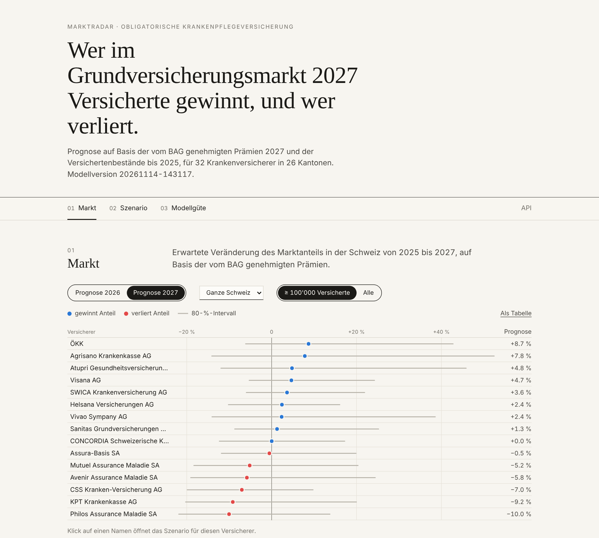

# Marktradar

Every autumn, after the new premiums are announced, a large number of people in Switzerland
switch their basic health insurer, and the premium compared with the competition is the
main driver. Marktradar turns that into a forecast. For every insurer and every canton it estimates how
the market share will change next year, and lets you ask "what if": what happens to
our portfolio if we price 2 percentage points above the market?

It runs entirely on **public data from the Federal Office of Public Health (BAG)**:
the approved premiums of all insurers (2011–2027) and the number of insured persons per
insurer and canton (2009–2025). No customer or claims data is needed.



## What you can do with it

- **See the market.** Who is likely to gain or lose share in 2027, nationally or in a
  single canton, based on the premiums the BAG has just approved.
- **Play through scenarios.** Pick an insurer, move the premium slider, and watch the
  expected change in insured persons, for Switzerland and for each canton.
- **Check how much to trust it.** Every number comes with an 80 % range, and a whole
  page shows how the model would have performed in past years.

A concrete example: CSS raised its 2027 premiums on average 2.9 percentage points more
than its canton markets. The model expects its national market share to fall by about
7 % by 2027 (80 % range: −20 % to +10 %), roughly 100,000 insured persons.

## Getting started

You need [uv](https://docs.astral.sh/uv/) and Git.

On macOS or Linux:

```bash
git clone https://github.com/niciamcompi/marktradar.git
cd marktradar
make pipeline   # download BAG data, build, train (a few minutes the first time)
make serve      # then open http://localhost:8000
```

On Windows (PowerShell), run these one at a time:

```powershell
cd $HOME
git clone https://github.com/niciamcompi/marktradar.git
cd marktradar
powershell -ExecutionPolicy Bypass -File .\tasks.ps1 pipeline
powershell -ExecutionPolicy Bypass -File .\tasks.ps1 serve
```

Then open **http://localhost:8000** for the web interface, or **/docs** for the API.

The first download is about 500 MB, because it fetches every yearly archive since 2011.
After that only the current files are refreshed.

If you prefer Docker, the image downloads the data and trains the model while it builds:

```bash
docker build -t marktradar .
docker run --rm -p 8000:8000 marktradar
```

## How it works

The idea is simple. People compare premiums within their canton, so the model looks at
each insurer *relative to its canton market*:

- the premium level compared with the canton average,
- the premium change the BAG approved for next year, compared with the market,
- how strongly the whole canton market's premiums rise (big increases make more people
  look around),
- the insurer's recent share trend and its size in the canton.

It learns from 15 years of history how canton market shares reacted to these signals,
using gradient boosting (scikit-learn). Canton forecasts are then added up to a national
figure.

The timing matters. The BAG publishes approved premiums at the end of September, before
the switching deadline on 30 November, while insured numbers come two years later. With
data up to 2025 and premiums up to 2027, the model forecasts 2026 and 2027 using only
information that is actually available today.

As reference premium it uses what every insurer must offer: adults, standard model,
CHF 300 deductible, accident cover included.

## How good is it?

Open the **Modellgüte** section in the web interface. For each past year, the model was
trained only on data available at that time and then compared with what really happened.

| | 1 year ahead | 2 years ahead |
|---|---|---|
| Error compared with "market share stays the same" | 20 % smaller | 16 % smaller |
| Rank correlation (does it order winners and losers right?) | 0.61 | 0.54 |
| Share of actual values inside the 80 % range | 76 % | 72 % |

That is useful, but not magic. Switching depends on a lot that is not in public data
(service, advertising, broker channels), and the years after the big premium increases
of 2023 and 2024 were clearly harder to predict. The [model card](MODEL_CARD.md) lists
all known limitations.

## It updates itself

New BAG data appears once a year. `marktradar update` (or `tasks.ps1 update`) handles it:

1. It checks the BAG catalogue. If nothing changed, it stops.
2. If there is new data, it first measures the current model on the years it has never
   seen. That is the most honest test there is, and the results appear in the web
   interface under *Live-Prüfung*.
3. It retrains, and only puts the new model into production if it is not worse than
   the old one.
4. It records the exact file versions in `config/data_manifest.json`.

On GitHub, the workflow `.github/workflows/daten-update.yml` runs this every Monday and
opens a pull request with a short report when there is something new. You review it and
merge. For that to work, enable *Settings → Actions → General → Allow GitHub Actions to
create and approve pull requests* once.

On Windows you can schedule it with the Task Scheduler:

```powershell
schtasks /Create /SC WEEKLY /D MON /ST 08:00 /TN "Marktradar Update" /TR "powershell -ExecutionPolicy Bypass -File $HOME\marktradar\tasks.ps1 update"
```

If a new model ever turns out worse in practice, go back with
`uv run marktradar promote <version>`. All versions stay in `models/`.

## Project layout

| Path | What it does |
|---|---|
| `config/config.yaml` | All settings: data sources, filters, model parameters, quality gate |
| `src/marktradar/data.py` | Downloads BAG files, reads three generations of file formats, validates |
| `src/marktradar/features.py` | Builds the canton-level features, with care for timing |
| `src/marktradar/model.py` | Model, prediction intervals, time-correct backtest |
| `src/marktradar/pipeline.py` | The steps download → build → train, shared by CLI and updates |
| `src/marktradar/registry.py` | Versioned models, quality gate, rollback |
| `src/marktradar/monitoring.py` | Live check of past models on new data |
| `src/marktradar/service.py` | Forecasts and scenarios, used by the API and the CLI |
| `src/marktradar/api.py`, `web/` | REST API and the web interface (no external dependencies) |
| `tests/` | Tests against a simulated BAG server, no network needed |

Useful commands:

```bash
uv run marktradar --help
uv run marktradar predict 8            # forecast for CSS (BAG number 8)
uv run marktradar predict 8 --curve    # premium elasticity curve
uv run marktradar backtest             # print the full backtest
make lint test                         # code quality and tests
```

## What you can learn from this project

If you are using it to sharpen your ML and deployment skills, these are the parts worth
reading closely:

- **Validating forecasts over time.** `model.backtest` trains only on the past for every
  test year. A random train/test split would leak the future and look far better than it is.
- **Avoiding leakage.** `features.py` documents when each piece of information becomes
  known. An earlier version of this project used realised average premiums, which looked
  more accurate but quietly used information from the future.
- **Honest baselines.** A model is only as good as its margin over the simplest guess.
- **Domain knowledge as constraints.** Monotonic constraints guarantee that a higher
  premium never predicts more growth.
- **Uncertainty.** Quantile regression plus conformal calibration, so the 80 % range
  actually holds about 80 % of the time.
- **Messy real-world data.** Three file formats, two encodings, two separators, total
  rows mixed into the data. All handled in one place and covered by tests.
- **MLOps.** Model registry, quality gate, data manifest, live monitoring, scheduled
  retraining that ends in a pull request rather than silently changing production.
- **Deployment.** Multi-stage Docker build, non-root container, health check, support
  for corporate registries and TLS proxies, CI on every push.

## Data sources

- BAG premium open data via
  [opendata.swiss: health-insurance-premiums](https://opendata.swiss/de/dataset/health-insurance-premiums)
  (approved premiums and insured persons per insurer and canton).
- BAG supervisory data (only used to look up insurer names).

Forecasts are estimates based on public data, not causal statements, and should not be the
only basis for a decision.
